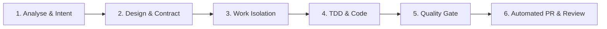

# Git & PR Workflow Skill

## 1. The 6-Stage Lifecycle

### Stage 1: Analysis & Context Gathering
- Inspect Flyway migrations, JPA entities, repository specifications, and Caffeine cache TTLs.
- Evaluate downstream impact on `card-collectionJava` export contracts.

### Stage 2: Architecture & Interface Design
- Formalize Flyway DDL (`V...__...sql`), DTO mappings (`CardJsonDto`), and transactional boundaries (`@Transactional(readOnly = true)`).
- Select execution model tier (Tier 1 Flash/Medium vs. Tier 2 Pro/Thinking) in `implementation_plan.md`.

### Stage 3: Branching & Work Isolation
- **Branch Protection:** Never commit directly to `main` (enforced via `.agents/hooks.json`).
- **Autonomous Branch Creation:** Switch to a dedicated topic branch before editing:
  - `feature/<description>` for new capabilities
  - `fix/<description>` for defect fixes
  - `chore/<description>` for configuration, skills, documentation, and dependencies
  - `migration/<description>` for schema updates

### Stage 4: TDD & Fast Inner Loop
- Iterate rapidly with `./mvnw test-compile` and `./mvnw test -Dtest=TargetClassTest`.
- Zero stubs or TODOs permitted.

### Stage 5: Quality Gate & Local Verification
- Run full suite: `./mvnw clean test` (or delegate to subagent).
- Validate Flyway scripts, dump synchronization (`Dump.sql`), and DTO backward compatibility.

### Stage 6: Automated PR & Handoff
- **Selective Git Staging:** Stage only files explicitly modified for the task (`git add <specific-file>`). **Never** run `git add .` or `git add -A` (enforced via `.agents/hooks.json`). Do not stage user overrides (`application-local.properties`, `card_collection.spf`) or unrelated DB dumps.
- **Conventional Commit:** Craft a semantic commit message (e.g. `feat(export): ...`, `fix(query): ...`, `chore(skills): ...`).
- **Push & Trigger Auto-PR:** Push the topic branch (`git push -u origin <branch-name>`) to trigger `.github/workflows/auto-pr.yml` and Jules CI validation, or open/verify the PR using `.github/pull_request_template.md`.
- **Never Leave Completed Work Uncommitted:** Execute the commit, push, and PR handoff automatically as the final step of each implementation task.
